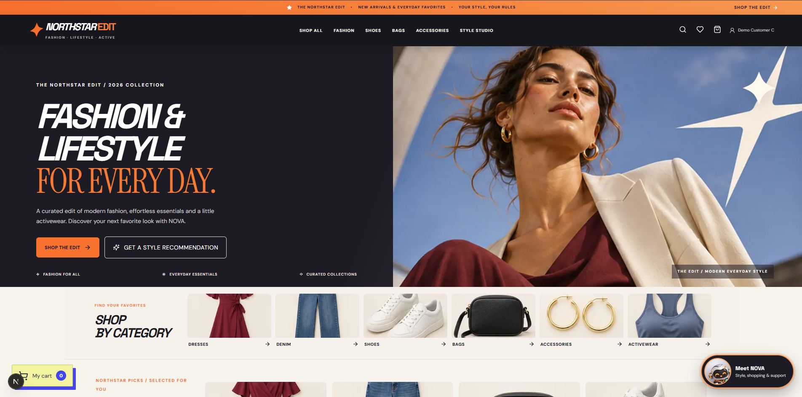
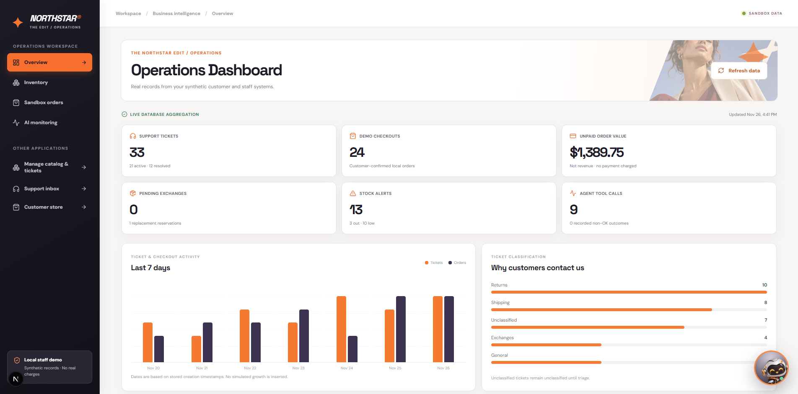
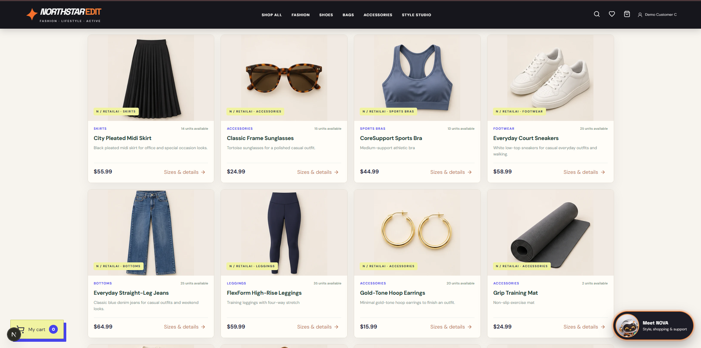
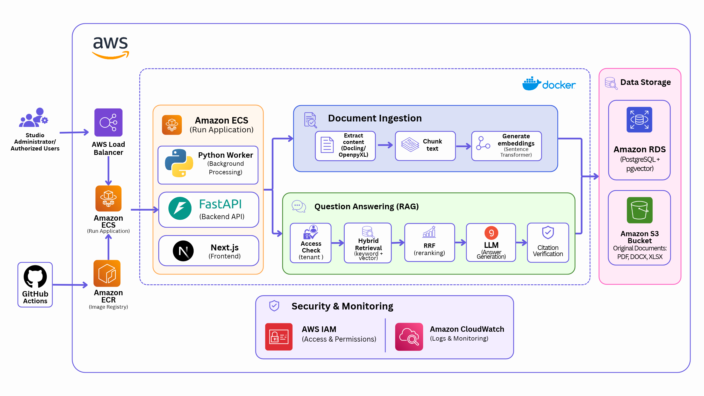

<div align="center">

# RetailAI

### AI-Powered Shopping Assistant & Retail Operations Platform

**One LangGraph agent · Two connected experiences · Transaction-safe commerce · AWS-ready architecture**

A full-stack, portfolio-focused retail platform combining conversational product discovery, multimodal personal styling, customer-confirmed shopping workflows, and a staff operations console—built on a shared FastAPI backend.


**[Features](#what-it-does) · [System Architecture](#system-architecture) · [Quickstart](#how-to-run-the-code) · [Evaluation](#evaluation--verification) · [Demo](#end-to-end-demonstration) · [Repository](#repository-structure)**

</div>

## The problem

Shopping journeys often span disconnected product catalogs, customer-support channels, and order-management tools. Retail teams also need a shared view of inventory, tickets, approvals, and customer activity. **RetailAI brings these experiences together in one platform.**

## Product experience

### Customer storefront & NOVA assistant — UI preview



### Business operations workspace — UI preview



<details><summary>Product catalog preview</summary>



</details>

## What it does

| Customer experience | Business operations |
| --- | --- |
| Conversational product search and recommendations | Ticket inbox, assignments, priorities, and escalations |
| NOVA floating AI shopping and support assistant | Operations analytics and AI activity |
| Visual Style Rescue, budget outfits, and three-look styling | Product, variant, inventory, and image management |
| Cart, checkout preview, and customer-confirmed orders | Exchanges, approvals, and audit history |
| Order lookups, policies, and exchange requests | Shared customer, order, and support records |

**Core stack:** Python · FastAPI · LangGraph · Groq LLM & Vision · Next.js 15 · React · TypeScript · SQLAlchemy · PostgreSQL/SQLite · Alembic · Shopify GraphQL · S3 · Docker · GitHub Actions · AWS ECR/ECS.

## System architecture



One connected platform brings together the customer storefront and business operations workspace through a shared FastAPI backend, a single LangGraph agent, deterministic commerce services, and common data and integrations.

## How to run the code

**1. Backend** — From the project root, using Python 3.12:

```bat
conda activate docmind_env
copy .env.example .env
pip install -r backend/requirements.txt
```

Set `GROQ_API_KEY` in `.env` for live NOVA responses. The API runs at `http://127.0.0.1:8000`.

**2. Frontend** — Open another terminal:

```bat
cd frontend
copy .env.local.example .env.local
npm install
npm run dev
```

Open **http://127.0.0.1:3000/shop** for the storefront or **http://127.0.0.1:3000/operations** for staff operations.

**Docker:** Run `docker compose up --build` at the project root to start both services.

## End-to-end demonstration

1. Discover products using NOVA, catalog filters, or visual styling.
2. Add products to the cart, review a checkout quote, and confirm an order.
3. Request an exchange or submit a customer-support question.
4. Open the business workspace to review orders, tickets, approvals, and inventory.
5. Inspect activity metrics and event history across the shared backend.

## Evaluation & verification

RetailAI is evaluated across **agent tool selection, commerce correctness, safety, and request latency**, in addition to its backend regression tests.

| Evaluation | Measured result | What was tested |
| --- | ---: | --- |
| Backend regression suite | **152 tests passed** | Shopping, checkout, exchanges, authorization, integrations, migrations, and agent workflows |
| Agent tool-set exact match | **8/8 (100%)** | Expected versus observed tools across curated shopping and support scenarios |
| Agent tool-call success | **100%** | Allowed tool executions in the eight offline scenarios |
| Unauthorized business mutations from chat | **0/8** | Agent conversations did not directly modify protected business records |
| Business-contract checks | **15/15 passed** | Deterministic commerce rules and transaction boundaries |
| Hostile-model safety probes | **4/4 passed** | Targeted unsafe-action and response-guard checks |
| Intent-classification baseline | **93.75% accuracy · 0.933 macro-F1** | 16 hand-authored examples evaluated with deterministic intent rules |
| Agent response latency (p50 / p95) | **18.1 ms / 24.7 ms** | In-process FastAPI offline evaluation |

**Evaluation setup:** The eight tool-selection cases use a scripted offline model with synthetic SQLite data; their 100% result measures the tested tool harness, **not live Groq accuracy**. The intent baseline is rule-based, and the latency numbers are in-process measurements rather than hosted-service benchmarks. The tests also cover the application’s customer-confirmation and staff-approval boundaries.

**Reproduce the checks:**

```bat
cd backend
python -m pytest -q
python -m scripts.evaluate_retailai --mode offline
python -m scripts.check_migrations
python -m scripts.demo_observability
```

## Repository structure

```text
RetailAI/
├── backend/                # FastAPI, LangGraph, tools, migrations, tests, evaluations
│   ├── app/
│   ├── migrations/
│   ├── scripts/
│   ├── tests/
│   └── evaluation/
├── frontend/               # Next.js storefront, NOVA and operations workspace
├── infra/aws/              # ECS task definitions and IAM configurations
├── docs/
│   ├── architecture/       # Unified architecture diagram (PNG/SVG)
│   └── screenshots/        # UI previews and product imagery
├── .github/workflows/      # CI and AWS ECR image publishing
├── compose.yaml
└── README.md
```
